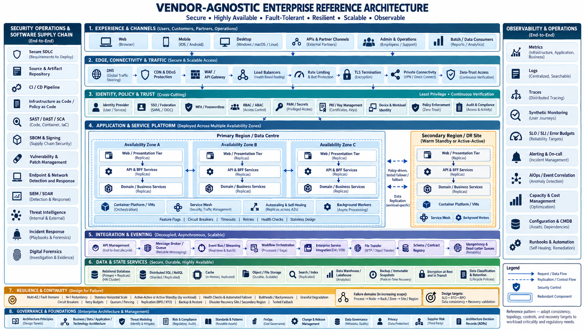

# SecuRAX — Enterprise Architecture alignment (the end-state blueprint)

<!-- status:start (from docs/status.yml; edit that file, then run docs/sync_status.py) -->
> **Status: 🟡 Partly built.** The target architecture; the seed runs today. Lights per capability in doc 59. [What the lights mean](../index.md#the-status-lights)
<!-- status:end -->

!!! info "Where this is heading"
    [{ width="420" }](59-END-STATE-ARCHITECTURE.md)

    The full end state, with a light on every box and the order to build them in: [doc 59](59-END-STATE-ARCHITECTURE.md).

This is the **target-state reference architecture** every current and future SecuRAX build must
map to. It mirrors the layers of a world-class, vendor-agnostic enterprise architecture — secure,
highly available, fault-tolerant, resilient, scalable, observable, AI-ready, data-mesh-enabled,
ESG-aligned — and shows, layer by layer, **what SecuRAX runs today (local-first)**, **the
end-state at scale**, and **the standard interface** that lets components talk with zero friction
and stay swappable. The one rule that keeps everything compatible:

> **Every component speaks an open standard behind a stable interface. Interfaces are the
> contract; implementations are swappable.** A new build that honours the interface plugs into
> the end-state with no rework — that is how we avoid lock-in and integration friction.

## The invariant interfaces (the "contract" — memorise these)
| Concern | Standard interface | Why it removes friction |
|---|---|---|
| AI models | **OpenAI-compatible** (`/v1/chat/completions`) via LiteLLM | any model (local/cloud/free) swaps without touching callers |
| Agents & tools | **MCP** (Model Context Protocol) | any client (Claude, local agent) drives any capability |
| Identity | **OIDC / SAML**, SCIM | one login plane; any IdP interchangeable |
| Secrets | **Vault/OpenBao API** | one secrets plane; no keys in code |
| Object storage | **S3 API** | MinIO ↔ cloud without code change |
| Telemetry | **OpenTelemetry (OTel)** | one pipe for metrics/logs/traces, any backend |
| Threat intel | **STIX/TAXII** | share/consume intel with any platform (CERT-In) |
| Services | **OpenAPI + GraphQL federation/BFF** | contract-first, independently deployable |
| Events/data | **CloudEvents + a data-mesh contract** (schema + lineage) | decoupled producers/consumers, self-serve data |
| Policy | **policy-as-code (OPA/Rego, Kyverno)** | one way to express/enforce rules everywhere |

## Layer-by-layer map (image → SecuRAX today → end-state)
**1. Experience & Channels** — *today:* Guiding Map PWA (the cockpit), MCP clients, CLI, APIs. *end-state:* + voice/multimodal agents, partner APIs, batch/data consumers. *interface:* PWA/OpenAPI/MCP.

**2. Edge, Connectivity & Traffic** — *today:* local nginx + the guardrail gateway; **Tailscale** (zero-trust mesh) as the private edge. *end-state:* DNS/CDN/WAF + API gateway, load balancers, rate limiting, 5G/MEC far/near edge for local inference. *interface:* HTTP + WireGuard; WAF/API-gateway OpenAPI.

**3. Identity, Policy & Trust** — *today:* planned **Keycloak** (OIDC/SSO/MFA, RBAC/ABAC), **OpenBao** (PAM/secrets); assume-breach, least blast radius. *end-state:* + passwordless/passkeys, decentralized identity/SSI (VCs). *interface:* OIDC/SAML/SCIM + Vault API.

**4. Application & Service Platform (+ AI/ML & Agentic AI)** — *today:* the **llm-gateway = Prompt-Engineering Gateway & Guardrails** (PEP), **MCP server = Agentic AI controller**, **LiteLLM = multi-model serving**, **Qdrant = vector DB/embeddings**, `assistant/`+`agents/` = agent layer, `learning/` = **RLHF-lite + ethical-AI/antifragility loop**, **model-registry = MLOps**. *end-state:* multi-AZ web/app tiers, GraphQL federation/BFF, real-time inference, service mesh, autoscaling/self-healing, background workers. *interface:* OpenAI-compatible + MCP + OpenAPI.

**5. Integration & Eventing** — *today:* **n8n** glue + the MCP tool catalog. *end-state:* API marketplace & governance catalog, **knowledge graph**, **federated data mesh & data products**, **data lakehouse**, data lineage & catalog. *interface:* CloudEvents + OpenAPI + data-product contracts.

**6. Data & State Services** — *today:* **PostgreSQL**, **MinIO** (S3), restic backups, guardrail **data classification (Red/Yellow/Green)** + retention, encryption in transit/at rest. *end-state:* + distributed SQL/NoSQL, cache, search/index, immutable snapshots. *interface:* SQL + S3 + the classification policy.

**7. Resilience & Continuity** — *today:* the **antifragility engine** (failures→strengths), red-team suite, immutable Git ledger, HITL. *end-state:* automated **chaos engineering**, cyber-resilience/immutable backups, AI-governance & ethics board, **ESG/GreenOps**, **automated FinOps** (the LiteLLM budget cap is the seed). *interface:* chaos experiments-as-code; FinOps budget API.

**8. Governance & Foundations** — *today:* `docs/securax/` (principles, operating model, compliance map), **ADRs**, threat modeling, policy-as-code (OPA/Conftest, Kyverno). *end-state:* full business/data/app/tech architecture, supplier-risk, privacy (DPDP), change/release. *interface:* ADRs + policy-as-code + the compliance map.

**Observability & Operations (end-to-end)** — *today:* gateway `/metrics` + `/healthz`, `./securax doctor`, board report. *end-state:* **Prometheus + Grafana + Loki + OTel**, synthetic monitoring, **SLO/SLI/error budgets**, **AIOps event correlation** (the AI-SOC triage is the seed), capacity/cost & **business-value observability**. *interface:* OpenTelemetry.

## End-state deep-dive: resilience, trust, supply-chain & data platform (image-8)
The layer map above is the skeleton; these are the cross-cutting concerns a *holistic* end-state
must name explicitly so no future build silently omits them. Each row: **what it means → SecuRAX
today → end-state → the standard interface/tool.** The rule stays the same — honour the interface
and you plug into the end-state with no rework.

### 7a. Disaster recovery & business continuity
| Concern | Today (local-first) | End-state | Target / interface |
|---|---|---|---|
| **RPO / RTO** (how much data / time you can lose) | daily restic + dated JSON exports; estate-sync per-key merge | tiered: RPO ≤ 15 min (async replica), RTO ≤ 1 h (warm standby) | documented per data class; tested in DR drill |
| **Secondary region / standby** | single box; Export/Import is the manual DR | warm standby in a 2nd region/cloud; Postgres streaming replica; MinIO/S3 cross-region replication | S3 replication + Postgres WAL |
| **Backups** | restic snapshots, Git ledger (immutable history) | **immutable/object-lock** backups (ransomware-proof), tested restores, offline copy | S3 Object-Lock / WORM |
| **Failback** | re-import on the recovered box | documented, rehearsed failover **and** failback; no split-brain | runbook + the annual DR drill (roadmap) |

### 7b. Resilience patterns (fault isolation under load/failure)
| Pattern | Today | End-state |
|---|---|---|
| **Fail-closed / timeouts** | gateway + estate-sync fail-closed; per-fetch timeouts in the research agent | every dependency call bounded by a timeout + deadline budget |
| **Bulkheads** | per-service `mem_limit`/`cpus` in compose | pool/quota isolation so one tenant/workload can't starve others |
| **Backpressure & rate limiting** | gateway `RATE_LIMIT_PER_MIN`; research agent step/page budgets | queue depth limits + load-shedding at the API gateway |
| **Circuit breakers & retry budgets** | fail-closed on upstream error | breakers + jittered retries with a **retry budget** (no retry storms) |
| **Graceful degradation** | Guiding Map works offline; "AI warming up" status; local-first fallback | cached/last-known-good responses; read-only mode under partial outage |
| **Idempotency & quorum/fencing** | estate-sync per-key timestamp merge (safe re-push) | idempotency keys on writes; quorum + fencing tokens for leader actions |

### 7c. Trust, crypto & workload identity (PKI)
| Concern | Today | End-state | Interface |
|---|---|---|---|
| **Secrets** | `.env` (git-ignored), fail-closed if unset; no keys in code | **Vault/OpenBao** with dynamic secrets + rotation | Vault API |
| **Key management** | TLS via the proxy; at-rest encryption assumed | **KMS/HSM**-backed keys, envelope encryption, rotation policy | KMS / PKCS#11 |
| **Certificates / mTLS** | Tailscale (WireGuard) private edge | internal **PKI + mTLS** service-to-service, short-lived certs, auto-renew | ACME / step-ca |
| **Device & workload identity** | device tokens (estate-sync), Tailscale node identity | **SPIFFE/SPIRE** workload IDs; passkeys for humans | SPIFFE SVID / OIDC |

### 7d. Software-supply-chain SecOps
| Concern | Today | End-state | Interface/tool |
|---|---|---|---|
| **SBOM** | CycloneDX SBOM generated in CI (`container-scan`) | SBOM per artifact, stored + diffed; VEX for exploitability | CycloneDX / SPDX |
| **Build provenance & signing** | SHA-pinned actions; gitleaks/Semgrep/Trivy gates | **Sigstore cosign** signatures + **SLSA** provenance; verify-on-deploy | cosign / in-toto |
| **Dependency & image risk** | Trivy (vuln+secret+misconfig), Semgrep SAST | continuous advisories + auto-PRs; admission blocks unsigned/vulnerable images | Trivy / Kyverno |
| **Runtime detection (EDR/NDR)** | fail-closed guardrails; AI-SOC triage seed | **Falco** (runtime), NDR/flow logs → the AI-SOC triage → SIEM | Falco / OTel / STIX |
| **IR & forensics** | immutable Git ledger; antifragility ledger | IR runbooks, evidence capture, immutable audit, tabletop drills | the IR runbook set |

### 5a. Messaging & data-in-motion (decoupling at scale)
| Concern | Today | End-state | Interface |
|---|---|---|---|
| **Broker / ESB** | n8n glue + MCP tool catalog (synchronous) | durable **message broker** (NATS/Kafka/RabbitMQ) for async, replay | CloudEvents over the broker |
| **Schema registry** | JSON contracts in code + the compose/PII CI gates | a **schema registry** with compatibility checks (producer/consumer safety) | Avro/Protobuf/JSON-Schema registry |
| **Delivery guarantees** | estate-sync idempotent merge | **idempotency keys + outbox pattern + DLQ** (no lost/dup events) | DLQ + consumer offsets |

### 6a. Data platform (state at scale)
| Concern | Today | End-state | Interface |
|---|---|---|---|
| **Cache** | in-process; localStorage on the PWA | **Redis/Valkey** for session/result/rate-limit state | Redis protocol |
| **Search / index** | pattern matching; AnythingLLM vectors | **OpenSearch/Meilisearch** + the vector DB (hybrid search) | OpenSearch API |
| **Warehouse / lakehouse** | Postgres + JSON exports | **DuckDB → ClickHouse/lakehouse**, CDC from Postgres, data-mesh products | SQL + Iceberg/Parquet |

### Ops excellence (run it like a service)
| Concern | Today | End-state |
|---|---|---|
| **CMDB / asset inventory** | capability catalog (doc 03) + AI-SPM inventory | a live **CMDB** fed by discovery; every asset owned + classified |
| **Runbooks** | `./securax doctor`, DEPLOY/FREEZE notes | a runbook per failure mode (DR, broker lag, cert expiry, key compromise) |
| **Synthetic monitoring** | `/healthz`, the PWA readiness ping | external **synthetic probes** (user journeys) + SLO/SLI **error budgets** |
| **Alerting & on-call** | board report; red CI (Andon) | alert routing, on-call, incident timeline, blameless post-mortems (Hansei) |

## Conformance rules — what every future build must satisfy
A build is "end-state-compatible" only if it ticks these (keep this as the PR checklist):
1. **Speaks a standard interface** from the table above — never a bespoke protocol.
2. **Local-first & swappable** — works offline/sovereign by default; cloud is opt-in and capped.
3. **Guarded** — any AI path goes through the gateway (PEP); any data respects Red/Yellow/Green.
4. **Observable** — emits health + metrics (OTel-ready); failures are capturable by the antifragility ledger.
5. **Governed** — policy-as-code where it enforces a rule; an ADR when it makes an architectural choice.
6. **No single point of failure** — a swappable alternative exists (capability catalog, Principle P-2).
7. **Least blast radius / zero-trust** — least privilege, private by default (Tailscale), assume breach.
8. **Resilient under failure** — every dependency call is bounded (timeout + retry budget), fails
   closed or degrades gracefully; writes are idempotent; no new single point of failure (rule 6).
9. **Recoverable** — its state is covered by a backup with a known RPO/RTO and a *tested* restore;
   nothing lives only in a container's writable layer.
10. **Supply-chain clean** — pinned deps, passes the SBOM + gitleaks + Semgrep + Trivy gates; a
    runtime artifact is signed/verifiable at the end-state (cosign/SLSA).
11. **Operable** — ships a health/synthetic check and, for a failure mode it introduces, a runbook
    line; emits enough telemetry to alert on (OTel).
12. **Tested from every angle** — see below.

## Continuous improvement + multi-perspective testing (the Kaizen discipline)
Borrowing the best time-tested methods — Toyota **Kaizen / Jidoka / Poka-yoke / Andon**, German
**Gründlichkeit** (thoroughness) and the **Swiss-cheese** defence-in-depth model — every change is
reviewed from **all tester perspectives before it ships**:

| Perspective | The question it asks | Where it runs |
|---|---|---|
| Functional | does it do what it should? | unit/behaviour tests (pytest, jsdom) |
| Security | can it be abused / leak data? | guardrails, red-team suite, PII/secret gate, gitleaks, Semgrep, Trivy |
| Reliability | what happens when a dependency fails? | fail-closed design, integrity guards, (end-state) chaos engineering |
| Performance | is it frugal with CPU/RAM/disk/tokens? | resource caps, LiteLLM budget, `./securax doctor` |
| Usability | can a non-expert use it without friction? | inline help, example seeds, the "one screen" test |
| Data/privacy | is PII classified and contained? | Red/Yellow/Green, DPDP alignment, the PII gate |
| Maintainability | will the next person (or you in a year) understand it? | ADRs, comments, the FREEZE "subtract" rule |

- **Poka-yoke (mistake-proofing):** CI gates make the wrong thing hard — the PII gate blocks a
  secret before it merges; the build-drift guard blocks a stale single-file build.
- **Jidoka (stop-the-line) + Andon:** a red CI gate stops the merge and surfaces the exact defect.
- **Kaizen:** every failure becomes a permanent strength via `learning/` (the antifragility score
  only goes up); every friction you hit becomes the next inline guide or the next capability.
- **Hansei (reflection):** the After-Action Review and Sunday Pulse in the cockpit apply the same
  reflect-and-improve loop to *you*, not just the code.

> One line: **standard interfaces keep the pieces compatible; the multi-perspective gates keep
> each piece correct; Kaizen keeps the whole thing getting better — so the end-state is reached
> by compounding small, verified steps, never a risky big-bang.**
