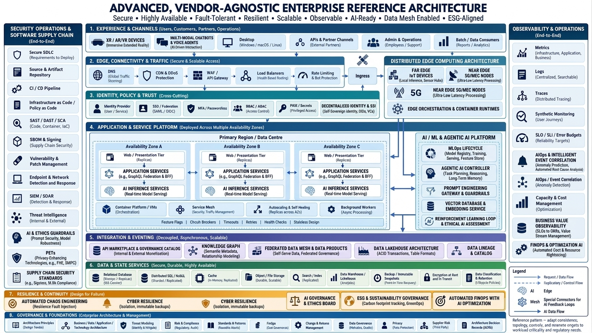

# 59 · The end state, and how SecuRAX gets there

<!-- status:start (from docs/status.yml; edit that file, then run docs/sync_status.py) -->
> **Status: 🟡 Partly built.** The end state; each capability below has its own light. [What the lights mean](../index.md#the-status-lights)
<!-- status:end -->

**Where it is going.** The two diagrams below are the enterprise end state SecuRAX is measured against. Every box gets a
light: 🟢 built and proven, 🟡 partly built or not yet proven, 🔴 not built yet. The **wiring order** at the end goes
from the easiest step to the hardest. Come back to this page whenever you wonder "what next?".

!!! tip "How to read this page"
    1. Look at the diagram: that is the destination.
    2. Find its layer in the tables: the light shows where SecuRAX stands today, and "Where in SecuRAX" says what does the job.
    3. Jump to the [wiring order](#the-wiring-order-easy-to-hard) for the next step that pays off most for the least effort.

## The destination

*The reference architecture: 8 layers, plus security operations on the left and observability on the right.*

??? note "The advanced version: AI-ready, data mesh, edge computing, ESG (click to open)"
    

    *The same layers, plus an AI/ML & agentic platform, distributed edge computing, a federated data mesh and ESG governance.*

**Honest scale check.** SecuRAX is one person's or one family's estate on one machine. Many enterprise boxes (multi-region,
CDN, service mesh) exist to serve thousands of users. On one host, building them would add cost and failure points without
adding safety. Those boxes stay 🔴 **on purpose**, marked *by design*, until a second machine or real users make them worth it.

## At a glance

| Layer | 🟢 | 🟡 | 🔴 |
|---|---|---|---|
| 1 Experience & channels | 3 | 4 | 1 |
| 2 Edge, connectivity & traffic | 3 | 3 | 2 |
| 3 Identity, policy & trust | 4 | 5 | 1 |
| 4 Application & service platform | 7 | 3 | 2 |
| 5 Integration & eventing | 0 | 3 | 5 |
| 6 Data & state | 1 | 5 | 4 |
| 7 Resilience & continuity | 5 | 2 | 4 |
| 8 Governance & foundations | 7 | 4 | 1 |
| Security operations (left column) | 9 | 4 | 1 |
| Observability (right column) | 4 | 5 | 1 |
| AI / ML & agentic (advanced diagram) | 4 | 4 | 2 |

## 1 · Experience & channels

| Box | Light | Where in SecuRAX | Next step |
|---|---|---|---|
| Web (browser) | 🟢 | Guiding Map PWA, Command Center, Chat (Open WebUI) | – |
| Mobile (iOS / Android) | 🟡 | The PWA installs on phones over Tailscale (doc 58); no native app | verify on a real phone; family Android app later |
| Desktop | 🟢 | Browser + `./securax` CLI on Windows (WSL), macOS, Linux | – |
| APIs & partner channels | 🟡 | OpenAI-compatible gateway API (`/v1`) | API keys per partner (`gateway-auth key add`) |
| Admin & operations | 🟢 | CLI, cockpit, `why`, `doctor` | – |
| Batch / data consumers | 🟡 | Evidence pack, cockpit JSON, reports | a stable export format |
| Chatbots & voice agents | 🟡 | Chat + the Twin; voice output (`./securax say`, ElevenLabs) wired, not proven | local speech in and out |
| XR / AR / VR devices | 🔴 | – | by design: not needed |

## 2 · Edge, connectivity & traffic

| Box | Light | Where in SecuRAX | Next step |
|---|---|---|---|
| DNS | 🟡 | `*.securax.localhost` names; Tailscale MagicDNS for devices | – |
| CDN & DDoS protection | 🔴 | – | by design: private estate, no public endpoint |
| WAF / API gateway | 🟢 | The guardrail gateway: prompt-attack rails, PII redaction, fail-closed | – |
| Load balancers | 🔴 | – | when a second machine exists (k3s burrow) |
| Rate limiting & bot protection | 🟢 | Gateway rate limit + lock-out | – |
| TLS termination | 🟢 | One HTTPS edge with hybrid post-quantum key exchange (docs 40, 41) | – |
| Private connectivity | 🟡 | Tailscale (WireGuard); built, not yet proven on a real device | verify (doc 58) |
| Zero-trust access | 🟡 | Tailscale device identity + optional gateway sign-in | turn on `gateway-auth` with per-device keys |

## 3 · Identity, policy & trust

| Box | Light | Where in SecuRAX | Next step |
|---|---|---|---|
| Identity provider | 🟡 | Keycloak in the sprout stage (dormant) | `./securax grow sprout` |
| SSO / federation (SAML, OIDC) | 🟡 | The gateway verifies OIDC/JWT tokens | wire Keycloak as the issuer |
| MFA / passwordless | 🟡 | The gateway can require an MFA claim | enforce it once Keycloak is on |
| RBAC / ABAC | 🟢 | Gateway roles per key | – |
| PAM / secrets | 🟡 | `.env` readable by you only; OpenBao in sprout (dormant) | move keys into OpenBao |
| PKI / key management | 🟢 | Private name-constrained CA; the CA key never enters a container | – |
| Device & workload identity | 🟡 | Tailscale device identity; no workload identity | – |
| Policy enforcement | 🟢 | Gateway as the only model path; OPA policies for cloud | – |
| Audit & compliance | 🟢 | Authenticated audit log, evidence pack | – |
| Decentralised identity (SSI, DIDs) | 🔴 | – | by design: not needed |

## 4 · Application & service platform

| Box | Light | Where in SecuRAX | Next step |
|---|---|---|---|
| Web / presentation tier | 🟢 | PWA, Command Center, Chat | – |
| API & BFF services | 🟢 | Gateway, sync service, router | – |
| Domain / business services | 🟢 | SOC triage, cockpit, advisors, planners | – |
| AI inference services | 🟢 | Local Ollama + free-first cloud ladders | – |
| Availability zones (A, B, C) | 🔴 | – | not claimed: one host (doc 55) |
| Secondary region / DR site | 🟡 | Encrypted, verified backups + restore; no warm standby | a second site holding encrypted copies |
| Container platform | 🟢 | Docker Compose; k3s on your own machines (burrow, partly proven) | – |
| Service mesh | 🔴 | – | only with k3s on several machines |
| Autoscaling & self-healing | 🟡 | Self-healing watchdog proven; `profile` sizes to the machine; no autoscaling | – |
| Background workers | 🟢 | Routines scheduler | – |
| Timeouts, retries, circuit breakers | 🟢 | Router timeouts, retry policy and cooldowns (doc 25) | – |
| Feature flags | 🟡 | Optional organs, residency monitor mode, guard on/off | – |

## 5 · Integration & eventing

| Box | Light | Where in SecuRAX | Next step |
|---|---|---|---|
| API management | 🟡 | The gateway; no developer portal or catalog | – |
| Message broker / queue | 🔴 | – | NATS, when two services need to hand work over |
| Event bus / streaming | 🔴 | – | – |
| Workflow orchestration | 🟡 | Routines (cron); n8n optional | – |
| Enterprise service integration | 🔴 | – | by design: not needed |
| File transfer | 🔴 | – | – |
| Schema / contract registry | 🔴 | – | – |
| Idempotency & dead-letter queues | 🟡 | Sync merges are idempotent and ordered (doc 55); no dead-letter queue | – |

## 6 · Data & state

| Box | Light | Where in SecuRAX | Next step |
|---|---|---|---|
| Relational database | 🟡 | SQLite per service, correct under concurrent writers | – |
| Distributed SQL / NoSQL | 🔴 | – | by design: one host |
| Cache | 🔴 | – | – |
| Object / file storage | 🟡 | SeaweedFS (S3) in sprout (dormant) | – |
| Search / vector index | 🟡 | Local embeddings + vector store in Chat and Private Docs | – |
| Data warehouse / lakehouse | 🔴 | – | – |
| Backup & immutable snapshots | 🟢 | Encrypted (AES-256), verified, restorable backups (journeys) | append-only copies off the machine |
| Encryption at rest & in transit | 🟡 | In transit 🟢 everywhere; at rest only for backups | full-disk encryption on the host (BitLocker / FileVault / LUKS) |
| Data classification & retention | 🟡 | Red / Green tiers drive residency routing; retention is manual | – |
| Federated data mesh / lineage / knowledge graph | 🔴 | – | by design: not needed |

## 7 · Resilience & continuity

| Box | Light | Where in SecuRAX | Next step |
|---|---|---|---|
| Health checks & automated failover | 🟢 | Container health, watchdog, model ladder failover | – |
| Graceful degradation | 🟢 | Local model floor; the app works offline | – |
| Retry budgets & circuit breakers | 🟢 | Router policy (doc 25) | – |
| Backup & restore | 🟢 | `backup_restore`, `backup_encrypted` journeys | – |
| Chaos engineering / game days | 🟢 | Game days inject real failures (doc 33) | – |
| Bulkheads & backpressure | 🟡 | Memory and CPU limits per container | – |
| Cyber resilience (isolation, immutable backups) | 🟡 | Isolated networks, encrypted backups; not immutable yet | append-only backup copy |
| Fault domains beyond one host | 🔴 | – | a second machine (doc 56) |
| Quorum / fencing | 🔴 | – | only with 3+ machines |
| DR site / secondary region | 🔴 | – | an encrypted off-site copy first |
| Tested failback | 🔴 | – | after a DR site exists |

## 8 · Governance & foundations

| Box | Light | Where in SecuRAX | Next step |
|---|---|---|---|
| Architecture principles | 🟢 | Doc 01, enforced by the build contract | – |
| Business / data / application / technology architecture | 🟡 | Doc 17 | – |
| Threat modelling | 🟡 | Purple-team loop + MITRE mapping; no written threat model per component | one STRIDE page per component |
| Risk & compliance | 🟢 | Regulatory maps (RBI, SEBI CSCRF, NIST AI 600-1), evidence pack | – |
| Standards & patterns | 🟢 | Build contract, diffcheck, forge | – |
| FinOps (cost governance) | 🟢 | Free-first ladders, the monthly budget cap | – |
| Change & release management | 🟢 | Safe update with automatic rollback; release workflow | – |
| Data governance | 🟡 | Residency policy and classes | – |
| Privacy | 🟢 | PII redaction, India residency mode | – |
| Supplier risk | 🟢 | `vet`, supply-chain ratchet, `inspect` | – |
| Architecture decision records | 🟡 | The adoption ledger and change log | one ADR file per big decision |
| ESG & sustainability governance | 🔴 | – | – |

## Security operations & software supply chain (left column)

| Box | Light | Where in SecuRAX | Next step |
|---|---|---|---|
| Secure SDLC | 🟢 | Build contract, diffcheck, forge gate | – |
| Source & artefact repository | 🟢 | GitHub, pinned images | – |
| CI / CD pipeline | 🟢 | Required-green CI with the real-estate sandbox | – |
| Infrastructure as code / policy as code | 🟢 | Terraform + OPA, validated in CI (cloud stays dormant) | – |
| SAST / DAST / SCA | 🟢 | SAST + secrets, Trivy, the red-team scorecard | – |
| SBOM & signing | 🟢 | SBOM, OpenSSF Scorecard, SLSA provenance | – |
| Vulnerability & patch management | 🟢 | Safe update, Dependabot, the image-age tile | – |
| Endpoint & network detection | 🟡 | Wazuh organ (dormant) | wake Wazuh |
| SIEM / SOAR | 🟡 | AI-SOC triage 🟢; Wazuh and TheHive dormant | – |
| Threat intelligence | 🟢 | Offline CISA KEV + MITRE ATT&CK; MISP dormant | – |
| Incident response | 🟢 | Runbook (doc 27) + regulator reporting clock | – |
| AI & ethics guardrails | 🟡 | Prompt-attack rails + Llama Guard (optional) | – |
| Privacy-enhancing technologies (FHE, SMPC) | 🔴 | – | by design: not needed |
| Digital forensics | 🟡 | The audit log only | – |

## Observability & operations (right column)

| Box | Light | Where in SecuRAX | Next step |
|---|---|---|---|
| Metrics | 🟡 | Cockpit KPIs; Prometheus in sprout (dormant) | wake sprout |
| Logs | 🟡 | Structured logs per container; no central store | a central, searchable log |
| Traces | 🟡 | `traceparent` carried through the gateway | – |
| Synthetic monitoring | 🟢 | `doctor`'s real chat test; sandbox journeys | – |
| SLO / SLI / error budgets | 🟡 | Fitness budgets | – |
| Alerting & on-call | 🟢 | ntfy andon: alerts only on change | – |
| AIOps / event correlation | 🔴 | – | – |
| Capacity & cost | 🟢 | `storage` forecast, `profile`, budget cap | – |
| Configuration & CMDB | 🟡 | Impact map, CBOM | – |
| Runbooks & automation | 🟢 | Runbook, routines, self-healing | – |

## AI / ML & agentic platform (advanced diagram)

| Box | Light | Where in SecuRAX | Next step |
|---|---|---|---|
| Prompt gateway & guardrails | 🟢 | The guardrail gateway | – |
| Vector database & embeddings | 🟢 | Local embeddings in Chat and Private Docs | – |
| Model serving | 🟢 | Ollama + the router | – |
| Model registry & governance | 🟢 | Catalog, model discovery and auto-repair | – |
| MLOps lifecycle (training, feature store) | 🟡 | Autobench measures models; no training | – |
| Agentic AI controller | 🟡 | Advisors, autobuild; long-term memory via the Twin | – |
| Feedback & ethical-AI loop | 🟡 | 👍 / 👎 is recorded; nothing learns from it yet | use it to choose the advisor prompts |
| Business-value observability | 🟡 | Guiding Map KPIs | – |
| Reinforcement-learning loop | 🔴 | – | – |
| Distributed edge (5G, MEC, IoT) | 🔴 | – | by design: not needed |

## The wiring order (easy to hard)

Each level builds on the one before. Most of level 1 is already 🟢; the work is in levels 2 and 3.

| Level | Effort | Steps | Turns these 🟡 / 🔴 boxes 🟢 |
|---|---|---|---|
| **1 · Use what is built** | hours | verify phones over Tailscale (`./securax phones`); switch on the docs site; `notify setup`; `routines install` | Mobile, Private connectivity |
| **2 · Harden the one machine** | a weekend | full-disk encryption on the host; an append-only backup copy off the machine; `gateway-auth enable` with a key per device; one STRIDE page per component; an ADR folder | Encryption at rest, Immutable backups, Zero-trust access, Threat modelling, ADRs |
| **3 · Wake the sprout** | 1–2 weeks | `./securax grow sprout` (Keycloak, OpenBao, SeaweedFS, Prometheus): SSO + MFA, secrets in a vault, central metrics and alert rules | IdP, SSO, MFA, Secrets, Metrics, Object storage |
| **4 · Wake the security organs** | 2–4 weeks | Wazuh (endpoint + SIEM), TheHive (cases), MISP (intel sharing); central logs | Endpoint detection, SIEM / SOAR, Logs |
| **5 · A second machine** | a purchase + a month | home rung (doc 56), then k3s on two or three machines you own: a second fault domain, load balancing, a warm standby | Fault domains, Load balancers, DR site, Failback, Quorum |
| **6 · Only if SecuRAX becomes a product** | months | multiple tenants, an API portal, a message bus, a data warehouse, certification | Integration & data boxes; doc 46 |

!!! note "Keeping this page true"
    A light changes only when a test or journey proves it (doc 55). When a box turns 🟢, update this page **and**
    `docs/status.yml` in the same change. The light at the top of every page comes from that file.
