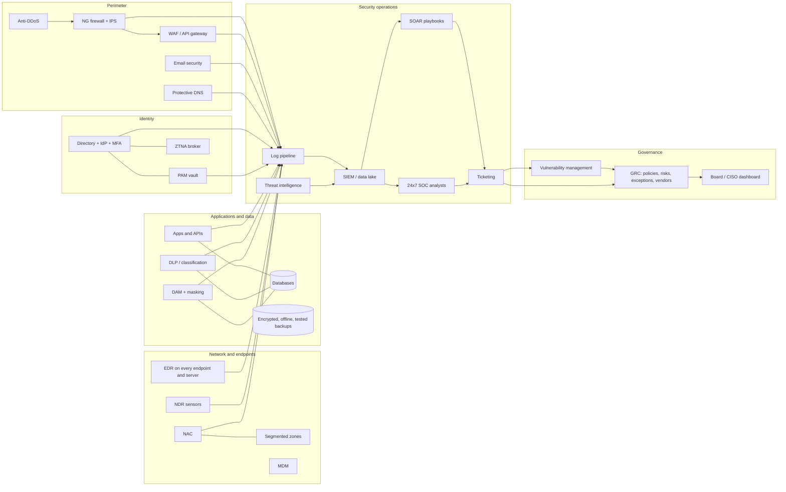

# 94 · Govern: for decision makers

<!-- status:start (from docs/status.yml; edit that file, then run docs/sync_status.py) -->
> **Status: 🟡 Partly built.** Built and tested: a tiered catalog across governance, people, process and technology; ./securax govern scores where you stand, the minimum basic and the highest possible, ranks the gaps with their 5W1H and an indicative India budget, sizes the team with roles, skills and certifications, writes the one-page Board report, and fills a template pack (policies, SOPs, registers, vision, executive deck, Board table). The Govern panel in the cockpit shows the capability stack and the organogram as pictures, with no command to run; every box opens a ready-reckoner page (vendors, indicative Indian cost, RFP pack, placement; a job description for each role), from research with sources dated October 2026. Budget bands are indicative and need quotes; the capability marks are yours to fill. [What the lights mean](../index.md#the-status-lights)
<!-- status:end -->

**The ask:** one place where a CISO or another executive sees:
- how the organisation is doing across governance, people, process and technology;
- what the minimum basic and the highest possible look like;
- for each gap, a recommendation that answers What, Why, Who, When, Where, How and How much;
- what people with what skills, what tools (with their architecture and data flow) and what processes it takes;
- a pack of ready templates anyone can use, even to start a company: policies, SOPs, registers, a vision document and an executive deck.

**The answer:** the Govern panel in the cockpit, `./securax govern`, and the template pack.

## What you see without typing a command

Open the cockpit and unfold **Govern**. Its one-line summary gives the maturity level, how much of the minimum basic is in place, the number of basic gaps, and the yearly cost to close them. Inside:

- **The capability stack, layer by layer:** governance, people and process on top, then the technology layers from the perimeter to resilience. Each capability is a chip: green done, amber partial, red dashed a missing basic, grey a later tier.
- **The organogram for the next tier:** the CISO, the programme office beside it, and one column per function with its lead and how many people of each role.
- **The next 10 to do:** open one to read its What, Why, Who, When, Where, How and How much.
- **What it costs, a year:** by tier, people and tools apart.

To put the two pictures into a Board deck:

```bash
./securax govern org --tier standard --out org.svg   # the organogram
./securax govern map --out stack.svg                 # the capability stack
```


## 1. Five minutes to a first picture

```bash
./securax govern profile --users 2000 --endpoints 2500 --apps 40 --sites 5 --coverage 24x7 --org "Your organisation"
./securax govern list                          # every capability, tiered, with its state
./securax govern mark tec-edr done             # mark what you have (partial counts half)
./securax govern                               # where you stand, budget to close the gaps, top recommendations (5W1H)
./securax govern team --tier standard          # the people: roles, how many, skills, certifications, cost
./securax govern board --out board.md          # the one-page Board report
./securax govern templates                     # the template pack, with your organisation's name filled in
```

Your answers and profile stay in `vault/`, which is private and never committed.

## 2. The three levels

| Tier | Means | Typical horizon |
|---|---|---|
| **Minimum basic** | What any organisation must have to be defensible: policy, inventory, classification, MFA, EDR, patching, vulnerability SLAs, tested offline backups, an incident plan, a team | 0-3 months |
| **Standard** | Good practice for a regulated or mid-size organisation: GRC, PAM, SIEM and a 24x7 SOC, AppSec in the pipeline, DLP, vendor risk, ISO certifications, drills | 3-12 months |
| **Highest possible** | Leading practice: zero trust, continuous threat exposure management, breach and attack simulation, deception, an API security platform, UEBA/XDR, quantum-safe readiness | 12-36 months |

The **maturity level** (1-5) is read straight from coverage:
1. Basics under 60%.
2. Basics under 100%.
3. All basics done; standard under 60%.
4. Standard at 60% or more; advanced under 40%.
5. Advanced at 40% or more.

## 3. How each recommendation is ranked

**Priority = impact (1-5) × tier weight (basic 3, standard 2, advanced 1) × gap (missing 1, partial 0.5).** So a missing basic with high impact always comes first. Each carries its 5W1H:

| W/H | Comes from |
|---|---|
| What, Why | The catalog (`governance/govern.json`), in plain words |
| Who | The owning role |
| When | The tier's horizon |
| Where | The layer: governance, people, perimeter, network, endpoint, identity, application, data, security operations, resilience |
| How | The steps, and the template that starts it |
| How much | An indicative band, Rs a year, scaled to your users and endpoints |

## 4. The people

`./securax govern team` sizes the team from your organisation, using plain ratios you can challenge:

| Role | Minimum basic | Standard | Highest possible |
|---|---|---|---|
| CISO | 1 | 1 | 1 |
| GRC lead / analysts | 1 / 1 per 2,500 users | 1 / 1 per 2,000 | 1 / 1 per 1,500 |
| Security architect | none | 1 | 1 per 40 applications |
| Testing lead / testers | none / 1 per 40 apps | 1 / 1 per 20 | 1 / 1 per 12 |
| Engineering lead / engineers | none / 1 per 3,000 endpoints | 1 / 1 per 2,000 | 1 / 1 per 1,500 |
| SOC manager / L2 / L1 | none / 1 (to run a managed SOC) / none | 1 / 2 per seat / managed | 1 / 2 per seat + 1 / 5 per 24x7 seat (in-house) |
| IR lead / DFIR | none | 1 / none | 1 / 1 per 5,000 endpoints |
| Resilience lead, programme manager | none | 1 each (programme manager from 8 people) | 1 each |

A 24x7 seat needs about 5 people to cover the week with leave. Each role carries its key skills, its usual certifications (CISSP, CISM, CRISC, CISA, CCSP, OSCP, GCIH, GCFA, SC-200 and others) and a salary band.

A common way to staff quickly: consultants lead in year 1 and train the internal team, and the internal team leads in year 2.

## 5. The reference architecture



### The data flow, in words

1. **Every control writes events** (allowed, blocked, logged in, changed) to one log pipeline. Logs are kept at least 180 days, as the CERT-In directions require.
2. **The SIEM** joins them with threat intelligence and raises alerts from use cases mapped to MITRE ATT&CK.
3. **SOAR** handles the routine alerts by itself, for example blocking an indicator or disabling an account. The rest go to **SOC analysts**.
4. **Every confirmed issue becomes a ticket** with an owner and an SLA. Vulnerabilities flow the same way from scanners, VAPT and attack surface management.
5. **GRC** holds what the tickets prove: risks, exceptions, vendor reviews and audit evidence.
6. **The dashboard and the Board report** are read from GRC and the SIEM, never typed by hand.

### The components

| Layer | Components (minimum basic **in bold**) | Feeds |
|---|---|---|
| Perimeter | **NG firewall + IPS**, **email security**, WAF, anti-DDoS, protective DNS, attack surface management | logs to SIEM; findings to VM |
| Network | Segmentation, NAC, NDR, ZTNA | logs to SIEM |
| Endpoint | **EDR + antivirus**, **patch management**, MDM, endpoint DLP | alerts to SOC; coverage to dashboard |
| Identity | **Directory + MFA**, IAM/IGA, PAM, AD hardening | sign-in and privilege events to SIEM |
| Application | Secure SDLC, SAST/DAST, API security checklist and platform, RASP, bot mitigation | findings to VM |
| Data | **Encryption**, **tested offline backups**, classification, DLP, DAM, masking, DRM | alerts to SOC; evidence to GRC |
| Security operations | **Central logging**, **vulnerability scanning**, SIEM, 24x7 SOC, SOAR, threat intelligence, UEBA/XDR, BAS, deception, forensics | tickets, metrics |
| Governance | **Policy**, **risk register**, **KPIs**, GRC, vendor risk, ISO 27001/22301, cyber insurance, AI governance | the Board report |

## 6. The template pack

`./securax govern templates [DIR] [--org "Name"]` writes these, with your organisation's name and today's date filled in. It never overwrites a copy you have already edited.

| File | What it is |
|---|---|
| `01-information-security-policy.md` | The top policy: purpose, scope, principles, roles, policy statements by area |
| `02-cyber-security-and-resilience-policy.md` | Prevent, detect, respond, recover, report; quarterly resilience metrics |
| `03-acceptable-use-policy.md` | Two pages every user reads and signs |
| `04-access-control-standard.md` | Joiner-mover-leaver, MFA, passwords, PAM, reviews |
| `05-data-classification-standard.md` | Sensitivity S1-S4 × criticality C1-C4 = priority P1-P3 |
| `06-vulnerability-management-sop.md` | The cycle, closure SLAs, VAPT rules |
| `07-incident-response-sop.md` | Severity, phases, regulator clocks, crisis team, playbooks, exercises |
| `08-change-and-exception-sop.md` | Change types; every exception owned, dated, compensated |
| `09-third-party-risk-questionnaire.md` | 12 questions, by vendor risk tier |
| `10-security-vision-and-strategy.md` | Vision, mission, principles, roadmap, RACI |
| `11-executive-deck.md` | A seven-slide executive briefing (Marp Markdown: open it in Marp, or paste it into PowerPoint) |
| `12-board-progress-table.md` | The 40,000-ft progress table: starting point, done, benefit, next step, support needed |
| `13-api-security-checklist.md` | 14 checks aligned to the OWASP API Security Top 10 |
| `asset-inventory.csv`, `risk-register.csv`, `exception-register.csv` | The three registers everything else depends on |

## 7. The numbers, and their limits

The budget bands are **indicative for India in October 2026**, drawn from public surveys and vendor material:
- **Salaries:** 2026 Indian surveys:
  - SOC L1 about Rs 3.5-7 LPA;
  - SOC L2 about Rs 8.5-16.5 LPA;
  - security architect about Rs 17-34 LPA;
  - CISO about Rs 40 LPA to Rs 1 crore.
- **SIEM and SOC:** Indian provider estimates:
  - a mid-market SIEM licence about Rs 40-80 lakh a year;
  - an in-house 24x7 SOC Rs 2-4 crore a year;
  - a managed SOC from a few lakh to about Rs 15-20 lakh a month.
- **EDR:** Indian reseller ranges of about Rs 2,200-5,000 per endpoint a year.

These sources are often vendor-written and disagree with each other. Use the bands to size a decision and frame a request for quotes, not as a price. Always get three quotes.

## 8. The ready reckoner: one click from a box to the answer

Every box in the capability stack and every box in the organogram opens a page. The pages carry no script, and their only outside links are their sources.

**A capability page** (all 62) answers what executive management asks:
- **What it is and what it protects**, in one paragraph.
- **Where it sits and how it works:** network zone, agent or cloud service; what feeds it and what it feeds.
- **The 20% that gives 80% of the value:** the features to insist on first.
- **At least three options in the market:** market leaders, an Indian vendor where a credible one exists, and an open-source option where a real one exists, each with its fit and India presence.
- **What it costs:** an indicative band in rupees for the reference organisation (2,000 users, 2,500 endpoints), excluding GST, and what moves the price. Always get three quotes.
- **An RFP pack to start from:** scope of work, mandatory and desirable specifications, sizing to give bidders, evaluation weights that sum to 100, service levels, and the India and BFSI clauses that apply (data localisation, RBI outsourcing and right to audit, CERT-In 6-hour reporting and 180-day logs, exit). Download it from the page, or run `./securax govern rfp tec-edr --org "Your organisation"`.
- **How you know it works** (KPIs), **common mistakes**, and the **sources**.

**A role page** (all 15) is a job description you can use:
- purpose, reporting line and responsibilities;
- must-have and good-to-have skills, experience, education and certifications;
- practical interview tests: a log to triage, a policy to critique, a scenario;
- the KPIs, an India salary band, and where good candidates come from.

The CISO page sets out what RBI's IT governance directions (2023) expect of the role: senior rank, reporting to an executive director or equivalent and not to the Head of IT, no business targets, and a minimum term.

**In a meeting, from the terminal:** `./securax govern reckon tec-siem` or `./securax govern reckon soc_l2`. A near-miss id suggests the right one.

**Where the research lives:** `governance/reckoner/*.json`, one file per layer plus `roles.json`.
- Every item has its sources and an `as_of` month (now October 2026).
- `./securax govern reckoner check` and a test fail if any capability or role loses its entry, a field, its third option or a source.
- The research also corrected the catalog's own cost bands. The cost table and the Board report now use the corrected bands. For example:
  - DLP, SIEM, privileged access, identity governance and zero trust access were too low;
  - the IR retainer and the HSMs for payment keys were missing.

**Its limits.** The research ran within a shared search budget. Most vendor facts and prices were checked by search or on the vendor's own pages; a few well-known facts rest on general knowledge, and the pages say "indicative". Re-check prices with three quotes and refresh the files every six months.

## 9. Proof

- **`test_govern.py`:**
  - every capability is complete and uses a known tier, domain and template;
  - marking a capability moves coverage and maturity;
  - a missing basic outranks a missing advanced item;
  - budgets scale with size and never count what is done;
  - the team grows with size and tier;
  - the Board report and the cockpit card carry the 5W1H, with no script and no external address;
  - the card is folded and shows the stack and the organogram as pictures, not commands;
  - both pictures export as standalone SVG files;
  - the templates fill in the name and never overwrite an edited copy.
- **`test_reckoner.py`:**
  - every capability and role has a complete, sourced entry with at least three options;
  - every box opens its page;
  - the pages carry no script and link out only to their sources;
  - the RFP pack has every section;
  - the terminal card answers by id and suggests on a near miss.
- **The cockpit:** it shows the Govern panel, folded. `test_cockpit_priority.py` checks one master lamp, at most three actions and folded panels. The cockpit journey checks the page still has no script and no external request.
